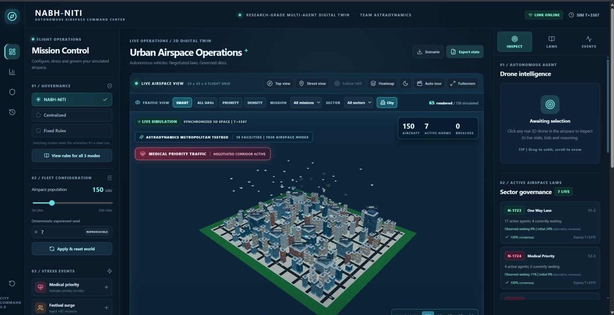

# NABH-NITI

**Adaptive 3D Airspace Governance for High-Density UAV Traffic**  
**Team AstraDynamics · AI3403 Multi-Agent Systems · IIT Hyderabad**

 

NABH-NITI is an interactive, research-oriented **multi-agent simulation** of urban drone traffic. Autonomous UAV agents plan routes through a discrete 3D grid, request movement slots, and (under the proposed policy) negotiate temporary local airspace rules. An independent safety layer checks all planned movements. The Python simulator drives a 3D React/Three.js browser dashboard through FastAPI and WebSockets.

> **Research scope:** This is a synthetic, discrete-time simulation, **not** real UAV control software or an aviation-certified separation service. Traffic norms here are implemented experimental policies, not legal flying permissions.



## What is implemented

| Component | Implementation |
|---|---|
| UAV agents | Five classes: medical, delivery, inspection, survey and cargo; missions, simulated energy, waiting, deadlines, bid and credit state |
| Airspace | Default **24 × 20 × 4** grid, **1,920** possible nodes, six-neighbor 3D A* routing |
| Common safety | Unique final grid positions, no head-on edge swaps, blocked-cell and boundary checks |
| Fixed Rules | Lower drone ID wins contested destination requests |
| Centralized | Global utility score based on mission priority, urgency and waiting |
| NABH-NITI | Local sector bidding, fairness credits and negotiated temporary operational norms |
| Four norms | Medical priority, congestion priority, one-way altitude lane, sector-entry quota; typically expire after **14 ticks** |
| Stress tests | Congestion, medical dispatch, festival surge, weather restriction, UAV failure / sector blackout, selfish bids |
| Digital twin | Procedural city, five bundled GLB drone models, Smart/All rendering, inspection, event log, replay and counterfactual comparisons |
| Evaluation | 1,080 archived 28-tick trials with matched seeds; independent shortest-path audit results |

A **tick** is one discrete simulation update, not one second. The rendered city is an illustrative environment, not a geographically accurate model of Hyderabad. A simulated safety check is not real-world collision certification.

## Quick start: Windows (recommended for demonstration)

Install **Python 3.11+** and **Node.js 22+**; internet is needed to install packages on first run.

```powershell
.\start_production_windows.bat
```

Open **http://127.0.0.1:8000**. The script installs requirements, builds the React interface, checks compiled assets and API/WebSocket operation, then starts a single local server. To end the server, press **Ctrl+C** in the terminal.

## Quick start: Linux / macOS

```bash
bash start_production.sh
```

Alternatively, use a development setup with separate terminals:

```bash
# terminal 1, project root
cd backend
python -m venv .venv
source .venv/bin/activate  # PowerShell: .venv\Scripts\Activate.ps1
python -m pip install -r requirements.txt
python -m uvicorn nabhniti.api:app --host 127.0.0.1 --port 8000

# terminal 2, project root
cd frontend
npm install
npm run dev
```

Development dashboard: **http://127.0.0.1:5173**. The deployed frontend is *built locally*; GitHub repository hosting alone does **not** provide a public live website.

## How to demonstrate

1. Select **NABH-NITI**, choose an initial fleet (for example 150 UAVs) and a reproducible seed.
2. Inject **Medical priority**, **Weather disruption**, **Festival surge**, **Peak congestion**, **Failure + blackout**, or **Selfish behavior**.
3. Click a UAV to inspect its mission, destination, route, priority and credits.
4. Open the **LAWS** view to observe active local norms, votes and expiry.
5. Open the **Research** view to run matched-policy comparisons and the exact-state counterfactual experiment.
6. Use **Smart** view when high density makes the 3D display crowded; all agents still run in Python even when fewer are shown.

## Reproduce and test

```bash
# From the repository root
cd backend
python -m pip install -r requirements.txt
python -m pytest -q
python -m nabhniti.experiments --preset smoke --out ../results/smoke.csv
python -m nabhniti.experiments --preset full --steps 28 --workers 4 --out ../results/full_1080_trials.csv
```

```bash
# From the repository root
python tools/verify_routing.py --cases 1000
python tools/verify_results.py
python tools/verify_showcase.py
cd frontend
npm install
npm run test:encoding
npm run test:visuals
npm run build
```

An uploaded CSV is provided at [`results/full_1080_trials.csv`](results/full_1080_trials.csv) with 6 scenario families × 3 starting fleet sizes (50, 200, 500) × 3 policies × 20 seeds = **1,080 trial records**, each covering **28 ticks**. Source data, descriptive plots and group summaries are kept in `results/`. The 90-tick comparison available in the website is a separate interactive experiment; **do not treat one such run as a 1,080-trial mean**.

| Metric (means across 360 trials/policy) | Fixed | Centralized | NABH-NITI |
|---|---:|---:|---:|
| Completed missions | **158.69** | 157.55 | 153.60 |
| Jain fairness (nonmedical movement opportunity) | 0.9734 | 0.9745 | **0.9775** |
| p95 cumulative wait (ticks) | 11.19 | 11.14 | **10.73** |
| Abstract logical messages | 0 | 15,365 | 4,476 |
| Recorded discrete safety breaches | 0 | 0 | 0 |

These are simulation observations: the NABH-NITI fairness/waiting benefit comes with a throughput cost. Abstract message counts do not measure transmitted bytes or latency. The independent `results/route_correctness_audit.json` contains the result **1,000/1,000 A* cases passing against a BFS reference**, not real-drone accuracy.

## Code, research and report

- [`backend/nabhniti/core.py`](backend/nabhniti/core.py) — UAV state, routing, bids, adaptive norms and movement safety.
- [`backend/nabhniti/api.py`](backend/nabhniti/api.py) — HTTP API, WebSockets, replay and what-if comparisons.
- [`backend/nabhniti/experiments.py`](backend/nabhniti/experiments.py) — reproducible paired trials and ablations.
- [`frontend/src/`](frontend/src/) — React dashboard, types, visualization and 3D city.
- [`docs/ARCHITECTURE.md`](docs/ARCHITECTURE.md) — subsystem and algorithm explanations.
- [`docs/VALIDATION.md`](docs/VALIDATION.md) — what tests establish and what they do not.
- [`docs/TEAM.md`](docs/TEAM.md) — contributions and academic attribution.
- **[Final group report (PDF)](reports/AstraDynamicsReport.pdf)** — the report to submit as a single PDF document.

## Team AstraDynamics

| Student | Roll number | Primary responsibility |
|---|---|---|
| Varja Krishna Koushik | AI23BTECH11031 | 3D airspace, A* routing, movement safety and Fixed Rules |
| Shreya Ratnagiri | ES24BTECH11031 | Adaptive sector governance and temporary norm engine |
| Mangamuri Venkata Pranati | CS23BTECH11034 | Negotiation, priority bidding, fairness and centralized benchmark |
| Rashmika Mandapalli | CS23BTECH11033 | Stress scenarios, failures, communication blackout and resilience |
| Bala Antony Poojitha | CS23BTECH11020 | Research experiments, metrics, integration and testing |
| Dhanavath Mohan Babu | CS23BTECH11014 | React/Three.js 3D command center, visual assets and interaction |

Source code and bundled procedural assets are supplied with an MIT license. Course/research use only. Repository: **https://github.com/koushik-varja/NABH-NITI**.
